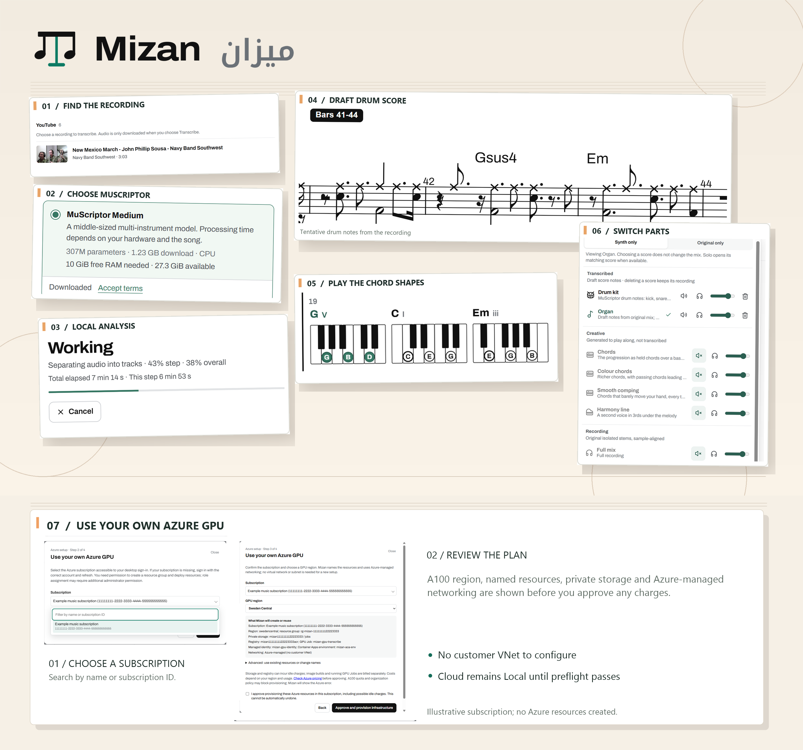

Mizan (ميزان, pronounced **mee-ZAHN**) means *balance* or *scale* in Arabic.

On Windows ARM64, Mizan analyzes YouTube recordings into draft scores, chords, and separate listening tracks. It also opens MIDI and MusicXML scores for playback and practice.

## Quickstart

1. [Install a signed MSIX](#build-and-install-an-msix) on Windows ARM64. The machine also needs the Microsoft Edge WebView2 Runtime.
2. Open Mizan. Under **Song analysis**, accept the terms for a MuScriptor model, save your Hugging Face read token, and download Small, Medium, or Large. Then paste a YouTube link and select **Transcribe**.
3. Wait for the job to finish, then select **Open song**. The job panel shows each step and a live elapsed time.
4. Choose a score to read, then use the Sounds and tracks picker to choose what you hear. Score selection does not change the audible mix.
5. Slow down, loop a few bars, or click a chord while paused to hear it. Try the generated Harmony line to practice along.

You can also import a MIDI or MusicXML score from the library.

**Model choice:** MuScriptor Small, Medium, and Large detect instrument-labelled notes from the mix, including piano, drums, and other parts. Small is the default; choose a size under **How Mizan finds notes** before starting a job.

**Cloud uses your Azure desktop sign-in.** Under **Song analysis**, choose **Set up Azure**. Sign in with an Azure Identity credential available to the installed app (such as `az login`), select an accessible subscription, choose an A100-supported region, and review the named resources and possible charges before approving. Mizan creates a dedicated resource group, private Blob storage, a registry, a managed identity and a GPU Container Apps environment. **Mizan-managed VNet** creates a dedicated VNet and delegated subnet with built-in defaults. **Custom VNet** starts with the same names and private address ranges prefilled, so you can change only what you need before approval; it creates a new VNet and subnet rather than using an existing one. Retrying the same saved setup checks existing infrastructure for compatibility, creates missing resources, and can retry a failed GPU environment after renewed cost approval; it does not reuse an existing GPU Job. Setup does not proceed to Job creation until the environment reports successful provisioning. If the environment fails after the worker is built, setup opens its recovery step directly: approve retrying the existing environment without rebuilding the worker or reentering subscription details. If Azure reports insufficient regional GPU capacity, retry later or choose another GPU region and new resource names.

The wizard builds the bundled GPU worker in your registry, pins its image digest, and—with separate consent—reads your saved Hugging Face token from Windows Credential Manager to bind it to the Azure Job. You do not need to enter it again. **Setup does not start a GPU Job or switch processing to Cloud.** Azure role assignments may require an administrator; Cloud remains Local until the current identity, Job, scoped permissions and private Blob access pass preflight. All three MuScriptor sizes can be selected for Cloud. A real A100 Job at 2 vCPU/8 GiB validated the Small-model host import/save path; Large completed a synthetic GPU worker run, while Medium and the full Medium/Large host paths remain unverified. New customer provisioning and each newly built worker image have not been live-verified; see [host/README.md](host/README.md#single-user-azure-gpu-offload).

Non-pilot setup also connects future Azure console and system logs to a same-resource-group Log Analytics workspace. Retention is 30 days; ingestion can add ongoing Azure charges, and logs from earlier runs are not retrieved. Existing-pilot Jobs stay unchanged unless you separately approve this logging connection.

## See Mizan



The Cloud setup screenshots use an illustrative subscription; no Azure resources were created for the collage.

## What Mizan makes

- **Scores:** Piano and drum notation, an isolated vocal melody, and instrument-labelled notes from MuScriptor.
- **Harmony:** Beats, key, and chords from pitched notes, with generated practice parts to play along. Drum-only scores stay drum-only.
- **Listening tracks:** The original recording and separate vocals, piano, guitar, bass, drums, and other sounds when HT-Demucs is available.
- **Practice tools:** A score cursor, piano roll, chord shapes, tempo control, loops, sampled playback, and a generated Harmony line.
- **Files:** Saved analysis, separated WAV files, MIDI, and MusicXML score exports.

The track picker separates notated scores, generated practice parts, and audio recordings. Guitar and bass listening tracks let you hear those sounds. MuScriptor may also add separate, draft instrument-labelled notes from the mix. HT-Demucs cannot isolate every detected instrument: its Other stem can contain several instruments. The exact `clean_electric_guitar` label uses the matching General MIDI guitar sample and is included in MIDI and MusicXML exports; other unverified instrument labels remain piano previews and are omitted from those exports.

## Architecture


The editable [system architecture diagram](docs/architecture.drawio) shows the Windows app, its local Python worker, local analysis and the optional Azure GPU branch. The [engine pipeline diagram](docs/engine-pipeline.drawio) distinguishes locally supported model sizes from Cloud's Small-only path; [model readiness](docs/engine-model-readiness.drawio) covers local downloads and their separate Azure secret.

The WinUI shell shows a React interface in WebView2. The interface sends JSON requests to the Python worker through the shell. The worker stores jobs and library data in SQLite. A local loopback server supplies saved audio and score files to the interface.

For a YouTube job, yt-dlp and FFmpeg get and decode audio. HT-Demucs makes six listening stems. MuScriptor reads the original mix and, for vocal melody, the vocal stem. In Cloud mode, only separation and note inference run on the Azure GPU; the desktop host still builds harmony and scores, saves the library result, and cleans up known remote Blobs. Beat This! and chroma analysis find timing and chords. MIDI and MusicXML imports go straight to the workspace.


The editable [Cloud architecture diagram](docs/cloud-architecture.drawio) traces subscription selection and consent, private storage and a pinned GPU Job, then the recording upload, remote Small-model processing, local library save and Blob cleanup. Azure access and quota/policy errors remain explicit; the diagram does not imply customer provisioning was tested live.

See [host/ENGINE.md](host/ENGINE.md) for model versions, measurements, licenses, and known limits.

## Use the library and workspace

The library searches saved songs first, then YouTube after a short pause. Search by title, artist, part, source, or folder. The browser-only Vite preview uses sample data; the desktop app uses the Python host for real searches and jobs.

**Redo analysis** reuses a saved recording. It also reuses all six stems if their audio and HT-Demucs version still match. Otherwise, Mizan separates the recording again. The old result stays available during the new job. Select **View progress** to return to an active job or **Open updated analysis** after it finishes.

The job panel shows total and per-step time. Instrument bars show isolated-stem loudness. CPU and RAM readouts cover the host and transcription worker.

The Sounds and tracks picker groups **Transcribed** scores, **Creative** practice parts, and **Recording** audio. Use mute, solo, and volume on each row. **Synth only** plays score notes; **Original only** plays the full recording. Selecting a score changes the view. You can delete a transcribed score while keeping its recording.

While paused, select a chord name or shape to hear it. During playback, chord clicks seek to that point. **Follow Melody** builds a practice line from the lead melody; **Follow Chords** builds one from chord tones.

Save practice positions in custom folders or use automatic folders such as **In progress**, Piano, Drums, Imported, and Recently added. A song can belong to several folders. Deleting a folder does not delete its songs.

## Choose a model

MuScriptor Small, Medium, and Large run on CPU with official non-commercial checkpoints. Accept each model's terms on Hugging Face, save a read-access token under **Hugging Face account & access**, and download the checkpoint in Mizan. The token stays in Windows Credential Manager. Mizan checks your available memory and storage before you choose a model or start a job. Without a usable checkpoint and enough memory, audio transcription cannot run.

Small and Medium can analyze the original mix while HT-Demucs makes listening tracks. The vocal-stem pass follows separation; Large runs separately.

## Import and playback limits

Imported MIDI and MusicXML keep their written time signatures, including odd and changing meters, pickups, partial measures, and tied notes. A shared bar timeline drives notation, navigation, loops, count-in, clicks, accompaniment, and exports.

New audio analyses derive rational grouping candidates from measured pulse and accent recurrence rather than choosing from a 3/4-or-4/4 list or a half-quarter grid. Distinct repeated accent boundaries can support changes every measure, including recurring alternating patterns and longer groups that are multiples of shorter ones. Verified acoustic changes are not replaced by fixed model labels at the same tempo. Missing or ambiguous boundaries and weak local patterns remain unverified; insufficient evidence uses an explicitly unverified 4/4 fallback. Confidence describes evidence support, not a calibrated probability. Acoustic grouping cannot prove written spelling (for example, 3/4 versus 6/8) or tempo subdivision. Existing saved analyses and source-note seconds are not rewritten; legacy songs without a bar timeline keep their original fixed bar lengths.

Very short positive partial measures keep their source coverage and notes. MusicXML exports use finer duration precision when needed. If a partial is below the score renderer's precision, its distinct note edges receive drawable spacing in the practice view only; navigation and highlighting still use the original bar positions and note timing.

MIDI uses repeated standard time-signature events to restart a partial bar, even when its signature is unchanged, and end-of-track timing to retain trailing rests. Its 480-tick quarter-note resolution cannot represent sub-tick spans losslessly; use MusicXML for finer source coverage.

Imports keep fractional-semitone pitches from MusicXML and static MIDI pitch bends. Playback and exports retain them within MIDI channel limits. Audio transcription uses twelve-tone piano and chord models.

The vocal score follows melody pitches and plays through a vowel synth. Organ-labelled notes use a synthesized organ sound. Imported MIDI and MusicXML retain non-piano General MIDI programs and play them from the bundled FluidR3 bank, which covers all 128 programs and loads only the programs and nearest usable sample roots used by a song. Native piano and drum playback keep their existing bundled samples. The app does not download instrument samples at startup.

For readability, low-confidence automatic notes can use a nearby sixteenth-note attack grid when neighboring attacks support it. A short sounding gate may be engraved with the logical span to the next attack and a staccato mark. This is a practice-notation approximation only: saved notes, audio timing and highlighting, MIDI, and MusicXML exports keep their source timing. Confident or imported notes and tightly spaced rapid attacks are not simplified.

To restore the bank from its pinned upstream source or verify the local files, run these commands from the repository root:

```powershell
node ui\scripts\install-instrument-samples.mjs
node ui\scripts\install-instrument-samples.mjs --verify
```

## Run from source

This repository targets Windows ARM64. Restore the host's Python 3.12 ARM64 environment as described in [host/README.md](host/README.md). For the older pywebview development host, run:

```powershell
Push-Location ui; npm run build; Pop-Location
$env:PYTHONPATH = "host"
host\.venv\Scripts\python.exe -m mizan
```

For the native WinUI shell, build the interface and start the shell:

```powershell
Push-Location ui; npm run build; Pop-Location
dotnet run --project shell\Mizan.Shell\Mizan.Shell.csproj -r win-arm64
```

Set `MIZAN_DEV_URL=http://localhost:5173` to use a running Vite server instead of `ui\dist`. Without that setting, the shell serves the built interface at `https://mizan.local`. Use a separate `MIZAN_HOME` and `MIZAN_ALLOW_MULTIPLE=1` if you run a dev instance beside the installed app. This keeps the test library separate from your songs. Set `MIZAN_MODELS_DIR="$env:LOCALAPPDATA\Mizan\models"` to use the already-downloaded models without copying them into the dev library.

## Build and install an MSIX

The root `mizan` package sets the desktop version. The `ui` package version is separate. Add a `mizan` [Changeset](.changeset/README.md) for a user-facing change. Run `npm run changeset:version` only when you are ready to group pending changes into one release. Put a one- or two-sentence summary above the detailed entries in [CHANGELOG.md](CHANGELOG.md).

The build needs the Windows SDK, .NET 10 SDK, and Node.js. It also needs Python 3.12 ARM64 with host dependencies and `pip-licenses`, plus a licensed FFmpeg distribution. Keep the FFmpeg license and readme with its binaries. Point `MIZAN_FFMPEG` at the executable, not a package-manager shim.

Build an unsigned installer:

```powershell
$version = (Get-Content package.json -Raw | ConvertFrom-Json).version
pwsh -NoProfile -File .\scripts\Build-Msix.ps1 -Version $version -SkipSign
```

Sign the MSIX with the configured Trusted Signing account, then install it:

```powershell
pwsh -NoProfile -File .\scripts\Publish-SignedMsix.ps1 -Version $version
Add-AppxPackage ".\artifacts\Mizan_$($version)_arm64.msix"
Start-Process 'shell:AppsFolder\Mizan_z0tvgrqshtgey!Mizan'
```

The signing script uploads only with `-Upload`. Installing a newer signed package preserves `%LOCALAPPDATA%\Mizan`. The installer bundles the app, media tools, samples, and license notices; checkpoints download separately. For redistribution, see [third-party notices](THIRD_PARTY_NOTICES.md) and FFmpeg's GPL source requirements.

For iterative test builds, keep the package version fixed and add a UTC build ID to the artifact name and packaged startup log:

```powershell
$version = "0.2.30"
$buildId = (Get-Date).ToUniversalTime().ToString("yyyyMMddTHHmmssZ")
$msix = ".\artifacts\Mizan_${version}_${buildId}_arm64.msix"
pwsh -NoProfile -File .\scripts\Build-Msix.ps1 -Version $version -BuildId $buildId -SkipSign
pwsh -NoProfile -File .\scripts\Publish-SignedMsix.ps1 -Version $version -MsixPath $msix
Add-AppxPackage -Path $msix
```

Do not change the product version to distinguish test artifacts. Windows blocks replacing changed contents when the same package identity and version are already installed (`0x80073CFB`); do not uninstall or alter the package revision as an automatic workaround.

## Tests

Run the host suite from the repository root:

```powershell
host\.venv\Scripts\python.exe -m pytest host\tests -q
```

With Vite running on `localhost:5173`, run the UI checks from `ui`:

```powershell
node tests\playback.mjs
node tests\meter.mjs
```

The browser tests use sample data and isolated Edge profiles. [host/ENGINE.md](host/ENGINE.md) covers model benchmarks. Run native-shell tests with a separate `MIZAN_HOME` and WebView2 profile.

## Credits and license

React, OpenSheetMusicDisplay, VexFlow, Lucide, NumPy, SciPy, ONNX Runtime, pywebview, and yt-dlp are part of the UI or host. HT-Demucs and Beat This! download their weights on first use; MuScriptor checkpoints require model access. The desktop runtime uses Python, .NET, FFmpeg, Windows ML, the Windows App SDK, and WebView2. Archivo and Noto Kufi Arabic provide fonts.

Mizan uses the [MIT License](LICENSE). Its dependencies keep their own licenses. See [third-party notices](THIRD_PARTY_NOTICES.md) for licenses, model sources, and redistribution requirements.
