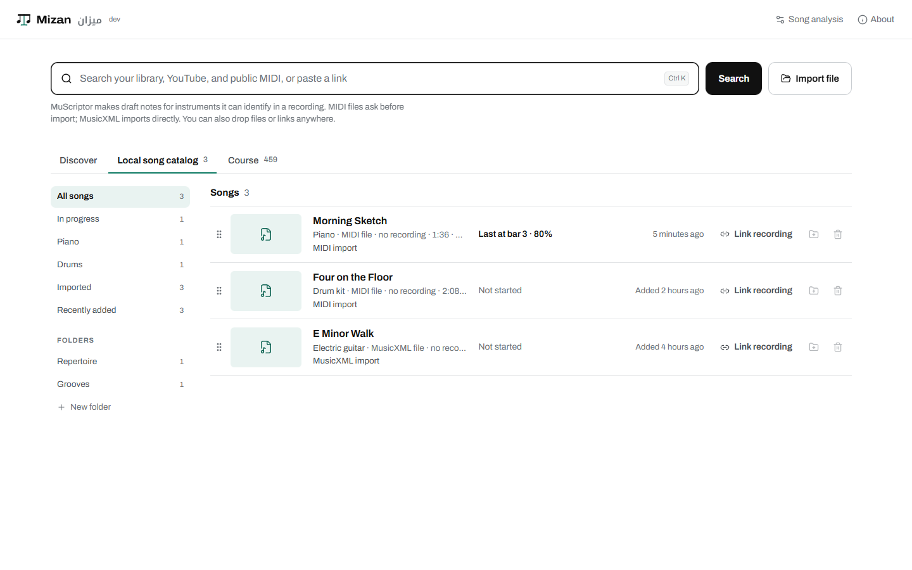
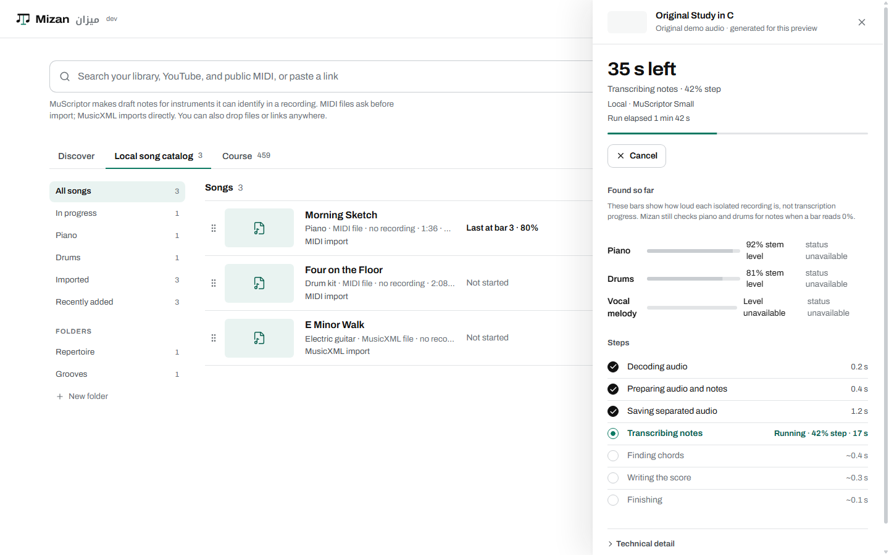
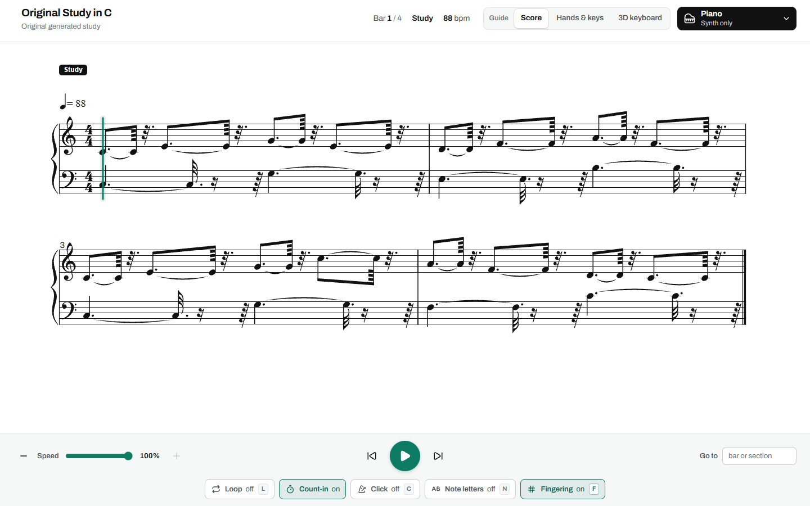
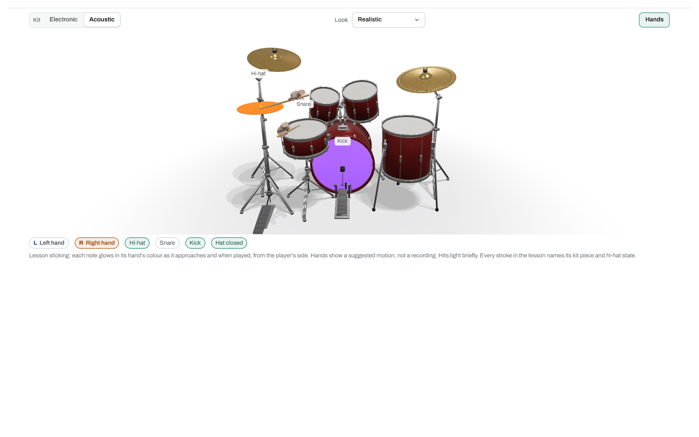
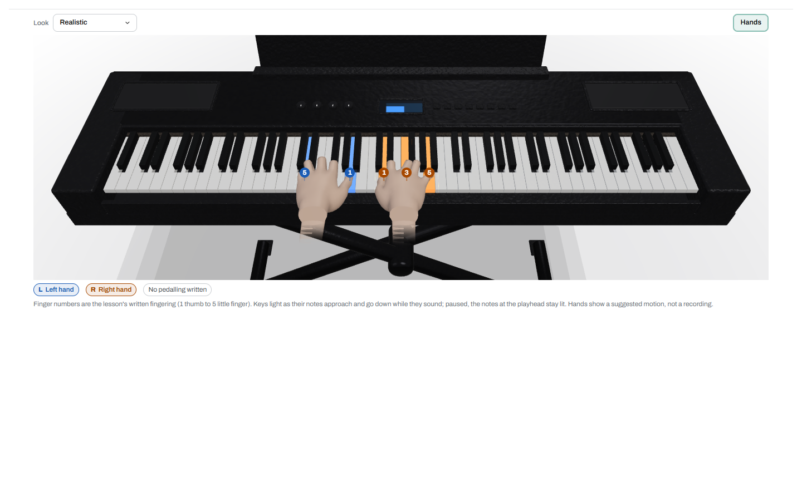
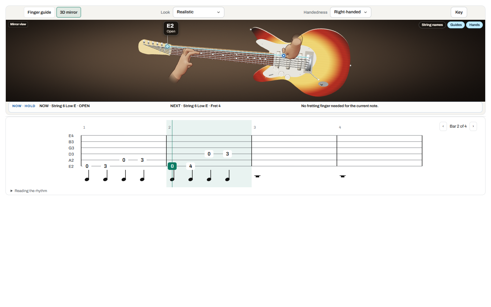
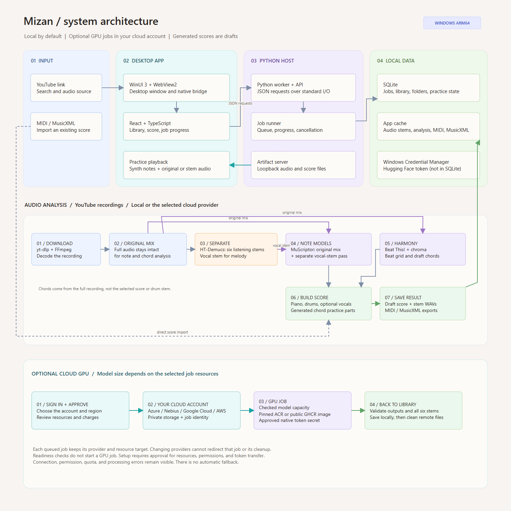
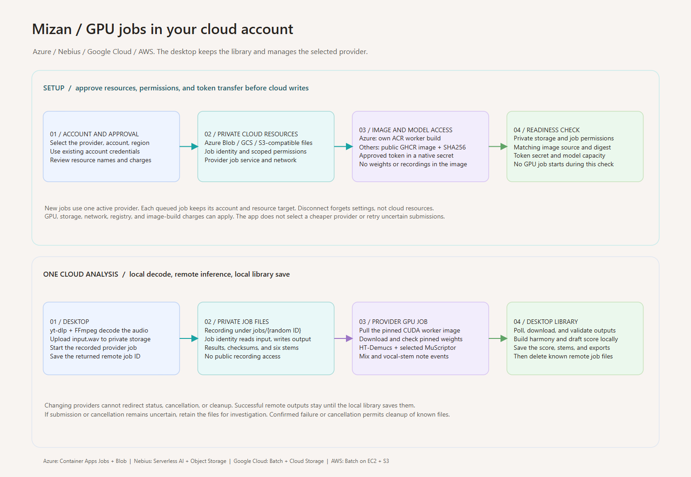

# Mizan

Mizan (ميزان, pronounced **mee-ZAHN**) means *balance* or *scale* in Arabic.
It is a Windows desktop app for turning music recordings and scores into
material musicians can study and practise.

Mizan can analyze a recording into draft notes and separated audio parts, or
open MIDI and MusicXML scores. Musicians can review parts in score and
instrument workspaces, slow down and loop playback, and export MIDI or
MusicXML. The app also includes original guitar and bass studies.

Audio processing runs locally by default. An optional cloud worker can run in Azure, Google Cloud, and Amazon Web Services.

## Screenshots

## Hands in practice

These short demos pair the app's practice views with original, computer-
generated exercises.

**Drums — generated eight-bar groove with score, variations, and fills (17 seconds)**

https://github.com/user-attachments/assets/8ce4c738-b1eb-49d3-9959-74391cbbd8fe

**Piano — generated melody with changing left-hand accompaniment (18 seconds)**

https://github.com/user-attachments/assets/24523ebb-e5d3-4a17-a8a1-3079b9195c37

The 3D piano includes a remembered overhead view with independently toggleable
animated hands, alongside the existing perspective and synchronized score.

**Guitar — generated study moving across frets 2 to 12 (12 seconds)**

https://github.com/user-attachments/assets/51b33939-686d-4c37-9be4-a1e8f5fe1145

## Architecture

The WinUI 3 shell hosts a React and TypeScript interface in WebView2. A local
Python host manages the library, processing jobs, and artifact server. Local
processing is the default; cloud jobs use a GPU worker in an account you
control.

The [engine flow](docs/engine-pipeline.png) and
[model readiness](docs/engine-model-readiness.png) diagrams describe local
processing and model checks.

See [cloud processing notes](docs/cloud-setup.md) for details about providers,
privacy, and costs.

## Project notes

MuScriptor model weights are not included. See [model notes](host/ENGINE.md) and
[third-party notices](THIRD_PARTY_NOTICES.md).

Mizan uses the [MIT License](LICENSE). Dependencies and model weights have
separate terms.
