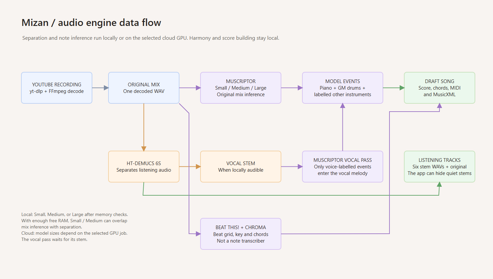
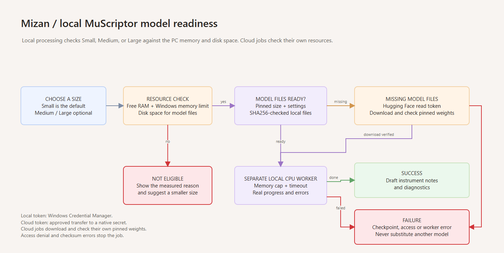

# Audio engine

The opt-in MuScriptor Medium W4A32 (full 30-second CC0 CPU comparison) and
separate FP16 (five-second CPU-versus-partial-QNN comparison) experiments are
documented in [README.md](README.md#experimental-muscriptor-medium-comparison)
and [README.md](README.md#opt-in-fp16-medium-cpu-versus-partial-qnn-experiment).
These unofficial conversions remain separate from the app's official
MuScriptor Small/Medium/Large CPU path. On the FP16 conversion, actual
QNN profile events were 25 fused QNN partitions plus 921 CPU nodes per
decoder step; CPU-only finished the same five-second audio faster
(4.26 s versus 8.69 s to decoded notes, excluding checksum verification;
warm 30.1 versus 69.5 ms/token in the repeat). Profile writing/parsing
added another ~1.14 s on the QNN side.
Executed-node profiles and end-to-end timings determine provider selection.
The HT-Demucs QNN setup did not finish a single 7.8-second chunk after
more than 30 minutes and approximately 29 GiB of working memory; it was
stopped without verified NPU nodes or valid output. The existing CPU
separation remains the only proven path. The Medium results do not justify
an unmeasured Large ONNX/NPU conversion; see the
[spike decision](README.md#ht-demucs-npu-and-muscriptor-large-decision).

## Implemented path

The default queue now runs inspect -> download -> decode -> separate ->
transcribe -> chords -> notation -> finalize. It produces a local study-aid
draft, not a performance-accurate score.

| Stage | Implementation | Execution |
|---|---|---|
| Inspect/download | yt-dlp subprocess, metadata, duration/disk preflight, progress, cancellation, structured errors | CPU/network |
| Decode | FFmpeg, 22,050 Hz stereo PCM; original title, URL and thumbnail retained | CPU |
| Separate | HT-Demucs 6s ONNX, overlapped 7.8-second chunks, six aligned listening stems | ARM CPU |
| Instrument notes | Official MuScriptor Small, Medium, or Large on the original mix; gated downloads and uncalibrated drafts for detected pitched instruments | PyTorch ARM CPU |
| Vocal melody | MuScriptor on the isolated HT-Demucs vocals stem when locally audible; only labelled `voice` notes become a tentative melody | PyTorch ARM CPU |
| Drums | MuScriptor's GM MIDI drum tokens mapped to kick, snare, closed/open hat, floor tom, high tom, ride and crash lanes | PyTorch ARM CPU |
| Harmony | Peak chroma, major/minor/7/maj7/m7/sus4 templates, unknown vs silence, key profiles, Roman numerals/roles, smoothing/merging | CPU |
| Rhythm/sections | Beat This! final0 ONNX beat/downbeat tracking; onset-grid fallback; numbered bar groups | CPU |
| Accompaniment | Deterministic root/fifth/octave LH; voice-led RH within C4-C6 and an octave span; block/arpeggio/pop from section energy | CPU |
| Export/finalize | Beats-based JSON with original seconds, multitrack MIDI, WAV candidates, atomic cache publication and SQLite metadata | CPU |

[Edit this data-flow diagram in draw.io](../docs/engine-pipeline.drawio).

Small and Medium can run the original-mix transcription alongside separation
when available memory allows; the vocal pass waits for the separated stem.
HT-Demucs makes listening audio, not instrument-labelled notes. Beat This!
and chroma supply timing and chord context, not a second note transcriber.
The **Preparing audio and notes** progress step covers the overlap of
separation, original-mix transcription, and instrument selection. **Saving
separated audio** times the stem WAV writes; `diagnostics.separate.inferenceSeconds`
retains the HT-Demucs inference time separately.

**Official MuScriptor** maps GM MIDI drum tokens
to separate lanes in `DRUM_LANES`, including floor tom, high tom, ride, crash
and open hat. Actual tom events depend on the model's detected notes.
MuScriptor's other instrument labels become individual pitched-note tracks
through `instrumentNotes` and `tracks`.

Model weights are not bundled. HT-Demucs 6s is downloaded on first use with a
pinned checksum. The mix and all six float WAV stems preserve the decoded
recording's sample count, rate, channels, and zero time origin. Learned
stems with sufficient local signal remain selectable; nearly silent learned
stems are hidden from the recording picker and omitted from new cached
results with a measured reason. The full mix always remains available.

Auto mode attempts **both piano and drums**, even when separator energy is weak
or zero. Relative stem RMS only orders the attempts; it is not an instrument
probability or a skip threshold. Explicit piano/drum requests attempt only the
requested instrument.

After transcription, `transcriptionQuality` reports event count, distinct
attacks, mean event confidence, absolute/relative stem RMS, and agreement with
the estimated sixteenth-note grid (only when a sufficiently confident beat grid
and at least four covered attacks exist; otherwise null). Conservative checks
flag sparse attacks, low event confidence, nearly silent stems, and irregular
drum timing. `usable` means a playable **draft**, not measured accuracy; the
summary never claims high confidence. `tentative` retains a draft only when
there is independent instrument evidence. Drum or vocal pitch/onset events can look
convincing even when the separator has captured leakage: `scoreWithheld`
records this decision separately from event confidence/count and omits the
unverified score, with an explicit warning. Recording visibility is assessed
separately: a sufficiently audible stem can remain selectable even without a
reliable score, while a nearly silent stem is not included in new cache artifacts.
The remaining tentative tracks have low bar confidence and reasons/warnings. `empty`
explicitly records the attempted instrument with no recovered events, without
inventing notes or claiming the instrument is absent. These heuristics are not
calibrated against a real-song ground-truth corpus.

The presence check was exercised against the 30-second checksum-pinned CC0
recordings: mixed piano+drums, piano-only (drums absent), drums-only (piano
absent), and mixes with either recorded instrument scaled to 10%. On the
learned separator, absent drums scored 0.1107 peak level in their loudest
100 ms despite 94 apparent hits; 10%-scaled real drums scored 0.2661.
A single recorded drum hit scaled to 10% scored 0.2018 in its loudest
100 ms, even though its whole-song RMS ratio was just 0.0576. These
references support the local drum evidence cutoff of 0.18; they do not
establish a calibrated instrument-presence probability. The no-piano drum
clip scored 0.00047 local peak versus 0.02457 for 10%-scaled piano. Vocal
absence examples peaked below 0.002 relative to the mix. Lacking labelled
positive vocal, guitar, bass, and other references, the near-zero visibility
checks for these parts are conservative but not validated for all quiet
positives; their newly omitted WAVs can be regenerated only by re-analysis.
`hiddenStems` and separation diagnostics state each decision, and the picker
excludes them for both newly analysed and reopened results. Only newly
generated temporary stem WAVs are removed before committing the result; the
manifest omits those names and aliases so cache validation and exports still
work. Existing cached analyses and their files are untouched until
re-analysed. A genuinely quieter part below measured leakage can still be
withheld; more labelled recordings are needed to establish sensitivity.
Historical HPSS tests produced similar candidate levels for absent drums and
quiet real drums; the app now requires HT-Demucs for listening stems.
Run the opt-in focused check with `MIZAN_CC0_SAMPLES` pointing at the pinned
sample directory: `python -m pytest tests/test_score_presence.py`.

Detected piano and dominant vocal notes may carry a fractional `midi` value.
Only stable events of at least 0.55 seconds with consistent pitch across three
or more sustain frames and corroborating harmonics are refined; sounds with
overlapping detected pitches, weak or inconsistent partials, short events,
vibrato, and pedal tails keep their original integer MIDI. No additional note
events are created. Estimated deviations below eight cents are treated as
near-12-TET tuning noise and retain the detected integer pitch (tested at ±6
cents); validated deviations are stored as fractional `midi` floats.
`diagnostics.transcribe.instruments.<instrument>.pitchRefinement`
counts notes that received cents estimates. A cents estimate is a static pitch
per note, **not** a continuous vibrato/bend contour. The existing MIDI pitch
bends and MusicXML fractional alters preserve these notes in exported scores;
key, chord and pitch-class analysis remain twelve-tone and do not recognize
maqam or microtonal keys. It is a deliberately bounded isolated-line feature,
not a polyphonic microtonal transcriber.

The following Basic Pitch and Standard results are historical research, not
the current transcription path. Synthetic harmonic vocal tones at ±50 cents tested with the pinned Basic Pitch
model measured -50.0 / +50.1 cents, versus 0 cents before refinement; a
12-TET tone remained at 0. The checksum-pinned CC0 VCSL B4 recording,
independently shifted by ±50 cents, measured -44.6 / +55.9 cents using a
**known B4 note event**; the original stayed at B4. These are isolated examples,
not an accuracy guarantee. On this same CC0 file Basic Pitch detected B5
instead of B4 (an octave error): pitch refinement correctly leaves it alone;
it cannot fix the note detector. The other pinned piano samples often lack a
strong fundamental and do not pass the conservative support check. No
precision is claimed for overlapping polyphony, dense mixes, vibrato or
unlabelled YouTube recordings. Run `python -m pytest tests/test_pitch_refinement.py`
with `MIZAN_TEST_MODEL` pointing to the verified Basic Pitch ONNX model and
`MIZAN_CC0_SAMPLES` pointing to the pinned recorded sample directory.
The piano Basic Pitch path also refined isolated harmonic test tones from
integer MIDI to -34.9 / +35.2 cents at ±35 cents input. At ±50 cents on this
test tone the piano detector emitted **two adjacent simultaneous notes**, so
the conservative overlap guard made no cents claim; the vocal path emitted
one dominant note and refined it. A model that resolves polyphonic contours
would be needed to improve that case without deleting genuine semitone chords.

## Provider evidence and packaging

`VerifiedModel` creates a session, executes representative input, checks
`session.get_providers()`, and parses actual ORT `Node` profiling events. An EP
advertised but assigned no executed nodes is rejected. Mixed assignment is
reported as mixed, with per-provider node executions/durations and a profile
path. Native provider failures and later inference failures trigger fallback;
they do not cause success-shaped empty transcriptions. Telemetry is disabled.
QNN is acquired from Windows ML's `ExecutionProviderCatalog`, then registered
with ONNX Runtime for the current Python process. DirectML is the in-process
Windows ML GPU provider; no x64 worker process is used.

Official PyPI checks and installation on this machine established:

- Python 3.12.10 is `win-arm64`. NumPy 2.5.3, SciPy 1.18.1,
  `onnxruntime-windowsml` 1.27.1, `wasdk-Microsoft.Windows.AI.MachineLearning`
  1.8.260209005 and ONNX 1.23.0 have compatible wheels and were installed.
- Windows ML requires the Windows App SDK Runtime. Its included providers are
  CPU and DirectML; QNN is downloaded/activated through `ExecutionProviderCatalog`
  and can fail cleanly when the driver/runtime is missing or the machine is
  offline.
- `numba` and `llvmlite` had no Windows ARM64 CPython 3.12 wheels in the
  inspected PyPI releases; the engine avoids librosa and their dependency chain.
- The existing FFmpeg 9.0.2 Gyan full build is PE `0x8664` (x64), running
  under Windows emulation. A real resampling/decode integration test passed.
  FFmpeg is not bundled or silently installed by this patch.

`MIZAN_PROVIDER=auto` uses a measured order **per ONNX model**. HT-Demucs
uses CPU; Beat This! always uses CPU because DirectML returned finite but wrong
logits for it (scattered 0.14-0.36 s beats and lost downbeats where CPU found a
steady pulse on the same cached excerpts). `qnn`/`dml` prefer just that
accelerator then CPU; `cpu` runs only CPU. The report, not the override's name,
tells which provider executed. DSP stages always report CPU.

### Measurements on this Snapdragon X Elite machine

Measured September 25, 2026; raw reports are retained beside this document.
Tiny-model results are ten-call medians. Basic Pitch results are five-call
medians on one 43,844-sample window. Initial session construction is separate.

| Model | QNN/HTP | DirectML/Adreno | ARM CPU |
|---|---:|---:|---:|
| 128-wide MatMul call | 0.183 ms | 704.474 ms | 0.0124 ms |
| Basic Pitch window call | 16-18 ms | 65 ms | 15-16 ms |
| Basic Pitch profiled node executions | 6 QNN partitions + 1410 CPU | 1410 DML + 30 CPU | 1440 CPU |

DirectML now runs in-process, but Basic Pitch is still slower on GPU than CPU.
QNN fused partition counts cannot be compared to unfused node counts as an
offload percentage. Provider selection keeps only EPs with profiled executed
nodes, not merely advertised availability.

The earlier HPSS-based, 60-second deterministic synthetic full-mix fixture, using cached weights
(no download time), produced:

| Path | Complete decoded-audio analysis | Piano transcription stage |
|---|---:|---:|
| Default QNN + CPU | 5.52 s | 2.65 s, including initial session setup |
| Forced ARM CPU | 3.57 s | 0.64 s |
| Forced DirectML + CPU | 41.41 s | See `engine-benchmark-dml.json` |

Default stage times: HPSS 2.13 s, harmony 0.73 s, accompaniment/MIDI 0.010 s.
The drum path was 3.32 s total; drum classification itself was 0.075 s.
Default benchmark peak host working set was 544.94 MiB including additional
provider probes; forced CPU was 246.24 MiB. These are process high-water marks,
not per-stage allocation totals.

The fixture's 120 BPM was estimated at **119.998 BPM**; its key was C major.
All 30 chord midpoints matched. Piano onset/pitch matching at a 150 ms tolerance
gave 90% precision and 75% recall (90 matched / 120 expected / 100 predicted);
matched-note mean onset error was 48 ms and mean offset error 139 ms. The drum
path produced 119 events and both paths generated 340 accompaniment notes.
These numbers characterize **only this synthetic fixture**. No representative
real-music accuracy, YouTube availability, dense-mix separation quality, or
eight-class drum accuracy is claimed.

The separate 32-second full-pipeline reference generated by
`python -m mizan.engine.quality_benchmark --output <path>.json` uses overlapping
synthetic piano chords and kick/snare/hat sounds with known event times. It
checks cached model hashes, keeps the normal library untouched, and reports
matched notes, grouped drum hits, time-weighted chords, stem projections,
runtime and peak memory. Baseline to quality-v5 on this **one fixture**:
The synthetic and pinned CC0 piano onset/full-note comparisons match pitches
within **15 cents**, not by exact float equality; onset tolerance remains
150 ms and offset tolerance is `max(50 ms, 20% of the reference note)`.
A semitone error is not a match. Previous benchmark reports produced before
this tolerance was added are not directly comparable to new F1 results.

| Measure | Previous | Quality-v5 |
|---|---:|---:|
| Piano pitch/onset F1 (150 ms) | 0.517 | 0.620 |
| Piano pitch/onset/offset F1 | 0.250 | 0.500 |
| Sustained piano offsets matched | 1/8 | 7/8 |
| Kick, snare, hat-group F1 | 1.00 each | 1.00 each |
| Chord coverage / accuracy including unknown | 1.00 / 1.00 | 0.766 / 0.766 |
| Chord accuracy when labelled | 1.00 | 1.00 |

The chord change deliberately leaves low-evidence spans unknown rather than
copying a nearby chord. A separate synthesized broadband/simultaneous-hit
stress fixture improved kick-group F1 from 0.75 to 1.00; the original kit-group
fixture stayed at 1.00. On the first 30 seconds of one unlabelled real recording,
kick-like events fell from 187 to 150, but **that count does not establish
accuracy**. The separator's synthetic piano stem carried almost no aligned
piano-source energy; this remains a major limitation. The retired Standard model did not recognize
separate guitars, bass notes, or individual hat/cymbal/tom types.
Official MuScriptor retains labelled pitched-note tracks from the
full mix and maps its GM drum tokens to individual kit lanes. Those detections
have not been validated against instrument-specific ground truth.
When selected, MuScriptor additionally transcribes a sufficiently audible
HT-Demucs vocal stem. Only its `voice` events are eligible for the dedicated
vocal score; unrelated stem-leakage labels remain excluded. The original-mix
detected-instrument notes are retained independently.

`python -m mizan.engine.real_sample_benchmark --samples <dir> --output <report>`
adds a reproducible 30-second reference made from checksum-pinned CC0 WAVs.
Recorded Kawai piano samples come from VCSL; kick, snare, and closed hi-hat come
from an explicitly CC0 drum-kit repository so an orchestral bass drum is not
mislabelled as a kick. The runner verifies every raw download and piano pitch,
onset-aligns and peak-scales the snippets, and writes reference mix and stems.
An E–G#m–B–E progression has labelled chord spans and an **E-major design key**;
the opening 0.5 seconds is N.C. Notes, kit hits and beat pulse are independently
labelled from assembly. It runs four single-factor backend configurations on
the **same fixture**, in order: auto learned models, HPSS instead of HT-Demucs,
spectral piano instead of Basic Pitch, and onset-grid instead of Beat This!.
`--variants learned dsp-separator` selects a subset; each run uses an isolated
analysis folder under `<report-stem>-work` and an isolated `MIZAN_HOME`. Provide
an **unused** report path; this workspace remains alongside the report so ORT
profile paths and stem WAVs remain inspectable. The runner only reads model
weights from `--models-from` and never downloads models or touches the library.
It records per-stage elapsed time, verified effective providers, actual methods,
model versions, note/drum/chord/key/beat scores, stem-source projection and
output shapes. Stage times include initialization and downstream work; the
single process high-water working set is **not** a per-variant memory comparison.
Beat matching uses 80 ms and counts duplicate guesses as false positives.
Separation projection estimates aligned source leakage but is **not** perceptual
quality or SDR. No labelled absent-instrument examples, accented downbeats,
guitar/bass/vocal scores, live performances or held-out songs are present. This
one assembled key example is not representative key accuracy. Extend `SAMPLES`
with checksum-pinned CC0 material and independent reference labels before
adding another model/fixture; do not tune thresholds on this test fixture.
There is no second drum decoder in the current engine: the drum hit/class
scores compare the **same** decoder fed by each separator, not competing drum
models. Auto-selection always includes piano and drums, so selecting both on
this positive fixture cannot establish instrument-detection specificity;
the learned separator also adds a vocals track without a vocal source.

One run on Snapdragon X Elite with identical 30-second mix SHA-256
`fa534ecb5ab0713448a4bcd0896ff4f6fc3c19e60818e53f85e70bbd86b73438`
(report: session `files/real-sample-model-comparison.json`; work folder alongside it):

| Variant | Wall / separator / transcription / beat+chords stage (s) | Piano onset / full F1 | Kick / snare / closed-hat F1 | Chord accuracy / coverage | Beat F1 |
|---|---|---|---|---|---|
| Learned baseline | 114.03 / 102.03 / 3.93 / 7.93 | .842 / .316 | .545 / 1 / 1 | .183 / .283 | .471 |
| HPSS separator | 32.59 / 2.48 / 3.67 / 26.20 | .841 / .449 | .667 / 1 / 1 | .183 / .283 | .471 |
| Spectral piano | 140.24 / 95.29 / 9.70 / 34.84 | .938 / .521 | .545 / 1 / 1 | .183 / .283 | .471 |
| Onset-grid beats | 116.02 / 109.32 / 5.58 / .87 | .842 / .316 | .545 / 1 / 1 | .183 / .267 | 0 |

HT-Demucs and Basic Pitch actually ran on CPU; Beat This! ran on DirectML
**and** CPU; HPSS/spectral/onset-grid ran as CPU DSP. The design key was
E major, but **all four predicted unknown**, so this single key check failed.
Learned piano/drum stem other-to-own projected energy ratios were .000149/.000289
versus HPSS .146961/.017706; unexplained fractions were .04130/.00361 versus
.40381/.04988. Spectral piano did better on this constructed fixture, not
evidence that it is generally a better model. Beat onset F1 only tests the
explicit 1-second pulse, not unlabelled downbeat/meter quality. The single
process peak host working set was 4,678.97 MiB. Each of the 24 generated stem
WAVs was verified as 661,500 stereo frames, matching the reference mix.
Elapsed times are sequential, non-controlled cold/warm runs on a shared machine;
do not rank model speed from small stage differences. The earlier 30-second
monophonic reference is a **different fixture**, not a before/after score.

### Opt-in instrument-presence comparison

`python -m mizan.engine.instrument_detection_benchmark --samples <cc0-dir>
--yamnet <yamnet.onnx> --output <report.json>` compares YAMNet AudioSet scores
against the existing `detect_instruments` stem-RMS ranking. Download the
16,093,355-byte ONNX model separately from
[`audiomagic/yamnet-onnx` at `f25b741c`](https://huggingface.co/audiomagic/yamnet-onnx/tree/f25b741c2f0bdc6d7e6db24b5fddda23347dbafd);
the runner requires SHA-256
`d3835ffbbd4a1bb3e777f0ca217b5007907f5171dd5d17c4236b95b2af8f908e`
**before inference**. It rechecks every CC0 sample hash and constructs the
same 30-second mix plus its clean piano-only and drums-only reference stems.
The default comparison uses the pinned HT-Demucs model in `--models-from`
(and fails instead of accepting a DSP fallback); `--separator dsp` explicitly
compares against the HPSS stem-RMS alternative. Weights are not added to the
installed application. The report records each clip's labelled presence,
score mean/max, executed provider, elapsed time, and process peak working set.
The CPU-only YAMNet path accepts mono 16 kHz float32 waveform `[N]` and reads
`output_0` `[frames,521]` at a 0.48-second stride. This **does not change auto
selection**: existing stem RMS orders both attempted instruments, and neither
method has a calibrated presence threshold. Clean reference stems provide
labelled negative cases, but these three related clips cannot establish
real-song specificity; no detection precision or event-onset metric is claimed.

The YAMNet ONNX conversion is [Apache-2.0](https://huggingface.co/audiomagic/yamnet-onnx/blob/f25b741c2f0bdc6d7e6db24b5fddda23347dbafd/README.md),
copyright 2022 Google LLC, converted by Audio Magic. The
[Google AudioSet labels](https://huggingface.co/audiomagic/yamnet-onnx/blob/f25b741c2f0bdc6d7e6db24b5fddda23347dbafd/yamnet_class_map.csv)
are CC BY 4.0: piano 148, drum kit 157, snare drum 160, bass drum 163,
hi-hat 167. These are sound-category scores, **not** drum-hit transcriptions.

Measured September 27, 2026 on Snapdragon X Elite using the same pinned
30-second fixture (raw reports: session
`files/instrument-detection-comparison.json` and
`files/instrument-detection-dsp-comparison.json`). Larger scores only mean
stronger evidence **within the same method**, not comparable probabilities
between YAMNet and RMS:

| Input (piano / drums truth) | YAMNet piano / drum-kit max | Learned stem-RMS piano / drums | HPSS stem-RMS piano / drums |
|---|---:|---:|---:|
| Mix (present / present) | .0119 / .0759 | .4323 / .8877 | .3850 / .8541 |
| Piano-only (present / absent) | .1273 / .0020 | .9498 / .0367 | .7723 / .4848 |
| Drums-only (absent / present) | .0049 / .7376 | .0003 / .9993 | .0940 / .9755 |

All YAMNet calls executed on ORT CPU, with 62 frames per clip and measured
inference times of .09–.42 seconds. Learned HT-Demucs executed on ORT CPU,
requiring 47.92, 61.86 and 78.09 seconds for mix, piano-only and drums-only;
HPSS/CPU-DSP required 2.12, 2.21 and 1.87 seconds, respectively. Process peak
working set was 4,730.92 MiB in the learned run and 399.48 MiB in the separate
HPSS run; these are **not** isolated per-model allocations or controlled speed
trials. The piano-in-mix YAMNet maximum is much lower than clean-piano
(.0119 vs .1273), and the HPSS drum RMS on piano-only is .4848 despite no
drums. These three related, constructed examples show score contrasts, not
a calibrated threshold, held-out precision, or evidence to replace the
default pipeline. No onset or kit-hit accuracy is measured here.

Real-song measurements on this Snapdragon X Elite (the v2 rows are earlier runs):

| Recording | HT-Demucs 6s | Beat/harmony stage | Total upgraded analysis | Peak working set |
|---|---:|---:|---:|---:|
| Cairokee - Ana Fadel, 276 s | 422.5 s, CPU | 25.7 s, DirectML + CPU | 470.3 s | 5.0 GiB |
| Beethoven - Für Elise, 175 s | 479.5 s, CPU | 35.8 s, DirectML + CPU | 551.8 s | 5.0 GiB |
| Cairokee - Ana Fadel, 276 s, v3 auto-both | 753.0 s, CPU | 23.8 s, DirectML + CPU | 835.3 s | 4.57 GiB |

The v3 run reused the cached original and cached models, with other work/tests
running on this shared machine. It is not a controlled speed comparison.
It recovered 453 drum-group events and 932 piano notes. Piano's relative RMS
was only 0.0449, but it was still transcribed; its mean event confidence of
0.4165 correctly marked it tentative/low confidence. The drum draft passed the
event/energy checks (mean event confidence 0.5876). Beat-grid confidence was
0.3643, so rhythmic consistency is explicitly null, not invented evidence.
All six WAVs matched the original 6,087,681 stereo samples at 22,050 Hz; chord
spans covered all 276.085 seconds without gaps. The sum of stems had 0.09895
relative RMS reconstruction error. Neither that residual nor event counts
measure instrument-isolation/transcription accuracy; no reference score or
listening-based quality judgement was available.

The learned separator remains the default for quality-oriented attempts, but
this measurement makes its latency/memory cost explicit. `MIZAN_SEPARATOR=dsp`
is the existing faster, lower-quality opt-out, not an equivalent replacement.

DirectML failed to execute HT-Demucs with an out-of-memory error, so automatic
selection uses CPU. Its CPU profile executed 1,170 nodes. Beat This! executed
1,359 profiled nodes on DirectML and 664 on CPU.

Raw evidence:
`provider-benchmark.json`, `engine-benchmark.json`,
`engine-benchmark-cpu.json`, `engine-benchmark-dml.json`,
[`engine-benchmark-cairokee.json`](engine-benchmark-cairokee.json).
ORT profiles referenced by them remain in the machine's app-data logs.

## Models, dependencies and licenses

| Item | Version/license | Selection |
|---|---|---|
| Spotify Basic Pitch weights | Official ICASSP 2022 ONNX at commit `fa5997af0a8210982619003269994a1be25eddf3`; Apache-2.0 | Historical benchmark only; not selected by the app |
| HT-Demucs 6s fp16-stored weights | StemSplit conversion revision `49df9b6`; MIT | Selected, 136 MB; first-use download |
| Beat This! final0 | JKU code and published weights; MIT; ONNX conversion revision `e2c0d43` | Selected, 82 MB plus frontend constants |
| NumPy | 2.5.3; BSD-3-Clause, with bundled component notices | Required |
| SciPy | 1.18.1; BSD-3-Clause, with bundled component notices | Required |
| ONNX Runtime Windows ML | 1.27.1; MIT plus third-party notices | Required; includes CPU and DirectML providers |
| Windows ML Python projection | `wasdk-Microsoft.Windows.AI.MachineLearning` 1.8.260209005; MIT plus Windows App SDK Runtime terms | Required for `ExecutionProviderCatalog` |
| Windows ML QNN EP | Catalog-installed `MicrosoftCorporationII.WinML.Qualcomm.QNN.EP.2`; Qualcomm binary license | Optional runtime acquisition for Snapdragon NPU |
| ONNX | 1.23.0; Apache-2.0 | Optional probe dependency only |
| mido | 1.3.3; MIT | MIDI export |
| yt-dlp | 2026.8.19; Unlicense for this Python distribution; bundled/executable components have their own notices | YouTube ingestion |
| FFmpeg | External installation; this Gyan build enables GPL and version3 | Used locally, not redistributed here |

Basic Pitch SHA-256:
`2c3c1d144bfa61ad236e92e169c13535c880469a12a047d4e73451f2c059a0ec`.
First-use download goes to a temporary file; the checksum is checked before
atomic replacement. Cached files are rechecked. Download/verification failures
produce a visible DSP-fallback warning; cancellation does not become a fallback.
Manifest/analysis metadata records the exact model commit, algorithm versions,
effective provider and timing. Offline cached-model use needs no network.

Runtime license labels do **not** imply proprietary accelerator libraries are
MIT. Preserve and review Windows App SDK Runtime, DirectML, catalog QNN and other
binary notices before making an installer. This work is not a redistribution
clearance.

Candidates not shipped:

- [Transkun](https://github.com/Yujia-Yan/Transkun) has MIT code/weights and a
  community ONNX export, but still needs a native six-window frontend,
  quadratic semi-CRF decoder, stitching, and attribute-head parity work.
- hFT-Transformer has MIT code, but the inspected release does not state
  separate checkpoint terms.
- [ADTOF](https://github.com/MZehren/ADTOF): upstream **CC BY-NC-SA 4.0**,
  with an original TensorFlow/Keras/madmom path and a separate linked PyTorch
  port. Integration needs a licensed Windows ARM64 checkpoint, its matching
  preprocessing, and a held-out comparison.
- [OaF Drums](https://magenta.tensorflow.org/oaf-drums): a TensorFlow solo-drum
  kit-hit/velocity pipeline. Integration needs a licensed Windows ARM64
  checkpoint, matching preprocessing and kit mapping, and a held-out comparison
  on separated drums. Neither candidate has that validated integration yet;
  their accuracy is not established by the current comparisons.

### Comparing candidate models

Freeze the same decoded recordings, annotated event times, train/test split,
class mapping, and metric code before comparing models. Use the CC-BY
[E-GMD](https://magenta.tensorflow.org/datasets/e-gmd) test performances for
solo-kit timbres and a separate private, manually checked set of dense mixes
with kick, snare, hats, toms, ride and crash labels. Do not tune on test songs,
publish copyrighted audio, or mistake synthetic fixtures for real recordings.
Run OaF Drums on the isolated drum stem, ADTOF on its intended full-mix input
(and report stem results separately), and the existing three-group DSP on the
same stem. Match onsets one-to-one within 50 ms; report per-piece precision,
recall, F1, false hits/minute, onset error and velocity error where supported.
Also report scores after mapping all systems to the **same** three broad groups
so a larger output vocabulary does not masquerade as an accuracy gain.

Check separation on each clip against its clean drum track when available.
Measure end-to-end results with and without separation, processing time and
peak memory on Windows ARM, effective ONNX providers, first-run download size
and checksum, and checkpoint redistribution terms. Do
not ship a model until it improves held-out results without hiding regressions
in any core class. For piano alternatives, compare pitch+onset and
pitch+onset+offset F1, sustained-note offsets, and false notes on the same
held-out source mixes; for beat/chord models compare downbeat alignment and
time-weighted chord accuracy including unknown spans.

Sources:
[Windows ML provider catalog](https://learn.microsoft.com/en-us/windows/ai/new-windows-ml/register-execution-providers),
[Windows ML installation](https://learn.microsoft.com/en-us/windows/ai/new-windows-ml/distributing-your-app),
[DirectML requirements](https://onnxruntime.ai/docs/execution-providers/DirectML-ExecutionProvider.html),
[Basic Pitch model and license](https://github.com/spotify/basic-pitch/tree/fa5997af0a8210982619003269994a1be25eddf3),
and official PyPI wheel metadata for the versions above.

## Result contract and persistence

The official MuScriptor Large **PyTorch CPU** experiment, verified checkpoint,
and measured single-fixture results are in [README.md](README.md#opt-in-official-muscriptor-large-cpu-spike).
Audio transcription has one model family and no substitute if a required
checkpoint, resource, or worker fails:

[Edit this model-readiness diagram in draw.io](../docs/engine-model-readiness.drawio).

Large's memory-mapped checkpoint load crashed in native PyTorch on this ARM64
machine; `safetensors`' `pread` backend loaded the same verified weights and
completed the 30-second CC0 benchmark. Its 217.69-second CPU inference, weak
20/60 drum recall, and inaccurate piano offsets favor letting users choose
the size rather than making Large the default. The app checks free physical RAM (Small/Medium/Large: 6/10/20 GiB), available
Windows commit (4/8/16 GiB), and disk space for any missing checkpoint plus
1 GiB headroom before model selection. The app's Large worker has a 16 GiB
process-memory cap; its inference deadline scales with song duration from
900 seconds up to 7,200 seconds. The standalone spike retains its separate
14 GiB cap. The earlier 14 GiB guard prevented Large from loading: its
measured peak committed memory was
14.09 GiB despite a 10.7 GiB peak working set. On a pinned 10-second CC0 mix,
Large used 186 and 173 CPU-seconds over 56.66 and 47.92 wall-seconds at four
threads; at twelve threads it used 289 and 255 CPU-seconds over 66.45 and
75.99 wall-seconds. Both settings produced identical note events. Large now
uses up to four threads on CPU; Medium retains up to twelve, which finished
the same mix in 20.31 seconds versus 23.96 at four and 30.85 at one thread.
In both models nearly all inference time is in sequential autoregressive
generation, so adding cores cannot make every CPU core busy. These are
single-machine, short-fixture results, not a promised speedup for every song
or device. HT-Demucs CPU
separation remains the listening-stem path regardless of note model.

`analysis.json` is the workspace `Song` object, not an envelope:

- Existing keys: `title`, `source` (source URL), `bpm`, `beatsPerBar`, `bars`,
  `key`, `sections`, `chords`, `piano`, `drums`, `confidence`, `tracks`.
- `accompaniment` uses the piano schema and includes `generated: true`;
  transcribed piano has `generated: false`. Its track id is `accompaniment`,
  instrument `piano`, name exactly `Generated accompaniment`.
- Only tracks containing produced events are listed. Drum-only jobs have no
  generated chord or accompaniment parts. Silence does not fabricate any
  playable track.
- Piano adds unquantized `onset`, `offset` (seconds), `velocity` and `confidence`.
  Drum events add unquantized `onset`, confidence and `possibleLanes`. All
  velocities/confidences are floats in [0, 1]. Chords retain seconds too.
- Timing is zero-based beats, bars/section start bars are one-based, and
  `beats` is a duration. When beats were tracked, `tempoMap` (score beat to
  recording seconds, the same piecewise map aligned imports use) follows the
  tracked beats; beat zero begins the bar before the first observed downbeat, so
  an anacrusis is a leading partial bar instead of shifting every barline.
  Sixteenth-beat snapping occurs only within 0.08 beats of that map;
  raw seconds are never overwritten. Beat conversion remains tied to original
  audio time, including leading silence, rather than trimming the recording.
- Chord `symbol: null` means uncertain; `"N.C."` means silence. Key can be null;
  numerals/roles remain null without a reliable key. Supported roles are
  `tonic`, `predominant`, `dominant`.
- `selectedInstruments` records actual scheduled attempts;
  `transcribedInstruments` records instruments with produced events.
  `transcriptionQuality` records completed attempts, including empty results.
  They are persisted in analysis/manifest/SQLite and exposed by both job APIs.
  Live jobs publish selection after separation and completed attempts as each
  decoder finishes. The panel labels energy as level, never as confidence.
- `beatsPerBar` is the number of quarter-note beats in one bar (3 for both
  3/4 and 6/8); `beatUnit` preserves the written denominator (4 for older
  songs). `timing` contains beat/downbeat seconds, phase, tempo confidence and
  meter confidence; `sectionEnergy`, `warnings`, `modelVersions`,
  `diagnostics`, `durationSeconds`, and `draft: true` are additive fields.
- Piano/drum confidence arrays contain exactly one label per bar, including
  low confidence for unobserved passages. Generated notes never inflate
  transcription confidence.

MIDI has separate transcribed and generated tracks, tempo/meter metadata, and
General MIDI percussion on channel 10. MusicXML remains the UI's responsibility.
The job panel uses these actual decisions for auto and explicit jobs; legacy
jobs without decision fields show unavailable status rather than guessing.

Results are built in a job-specific temporary directory, then renamed into
`cache\<job-id>` on success. SQLite's additive `details` column stores artifacts,
source metadata, warnings, diagnostics and versions. Cancellation before or just
after artifact publication removes partial results. Missing/damaged analysis is
not a reusable cache hit. Explicit DSP mode is cacheable; accidental auto-mode
model fallback is not, allowing a subsequent job to retry the model.

Reprocessing resolves the saved YouTube entry at execution time and checks its
source video ID. A readable decoded WAV from its `mix` or `original` artifact
is copied byte-for-byte into the new job's workspace and validated before use.
This skips YouTube inspection, download and FFmpeg decoding, preserving sample
rate, sample count and leading silence; duration comes from those samples.
The completed ingestion stages report cache-reuse methods and zero
download/decode time (validation/copy time belongs to inspect). No paths from
caller-supplied job details are used. The old cache is never moved, linked or
deleted by reprocessing, including failure/cancellation or new-result cleanup.
Missing, corrupt, unsupported or mismatched audio triggers an explicit warning
and normal YouTube ingestion; offline failures remain errors. Model acquisition
and verification are unchanged, so uncached models can still require network.
Linked MIDI/MusicXML recordings continue to use the separate alignment path.

Meter from tracked audio counts whole beats between Beat This! downbeats
(`tracked-downbeat-beat-count-v1`). Isolated missed or spurious downbeats do not
create signatures; a sustained phase shift leaves an unverified partial bar;
sustained or alternating different groups become signature changes, including
long groups such as 9 or 13 beats. Inside an interval spanning several primary
bars, a beat whose downbeat activation exceeds the song's ordinary beats (90th
percentile) is an observed weak downbeat. Inside a sustained run of shorter
groups with a steady beat, off-phase downbeats mostly weaker than the downbeat
before them show strong-weak pairing: they are half-bar accents, so the primary
bar stays (`unverified`) and the passage is listed in `observedShorterGroups`
with a warning. Otherwise observed longer or shorter groups, sustained (3 to 6,
6 to 3) or alternating (3,6 or 4,8), are kept as `unverified` bars rather than
split or merged into the primary bar. Any phase shift, ambiguous related group
or many missing downbeats marks the bars `unverified`. When transcribed note
onsets divide the tracked beat in thirds over a passage (off-beat onsets closer
to the third grid than the quarter grid, at least 75% with eight or more votes
nearby), the tracked pulse there is a dotted quarter: those bars are written in
compound time (four tracked beats become 12/8, two become 6/8) and the tempo map
numbers each such tracked beat as 1.5 quarter beats; recording seconds do not
change. One differing bar between agreeing neighbours follows them. Without
onset evidence (imports, DSP-only analysis) bars keep simple time. 12/8 and a
triple-feel 6/4 have the same bar length and cannot be told apart from onsets.
When every bar is a tracked 3/4 group and the recording's own attacks (log
spectral flux below 5.5 kHz, ±45 ms) put the mid-group eighth above tracked
beats two and three in at least half of the bars and in every quarter of the
song, while the other between-beat eighths are as strong as the tracked beats
(at least 0.85 of them), the tracker followed every other felt beat of a fast
triple meter: the tempo is doubled and each group is written as two 3/4 bars
(pickups and endings split at their true edges), the inserted barlines are
`unverified`, and recording seconds do not change. A true triple bar accents
beats two and three, and a waltz with a syncopated "and of two" keeps its other
off-beats weak, so neither is re-read. Playback clicks count a leading pickup
back from the first downbeat and do not accent its first pulse.
The count gives a grouping
in tracked beats, not a written denominator or tempo octave (the same song can
track at 92 or 184 BPM).
Drum notation writes automatic hits on the bar's sixteenth grid (UI score and
MusicXML export share the rule). A same-lane fine figure whose spacing fits the
64th or sixteenth-triplet grid (three or more consistent hits, or an isolated
pair 0.1-0.2 beat apart) is written on that grid, with 3:2 triplet values; other
spacing is treated as jitter. Imported hits keep their rhythm and playback uses
the source beat.

Remaining limits: Beat This! cannot distinguish 3/4 from 6/8 or a tempo octave;
without downbeat evidence analysis retains 4/4. MIDI/MusicXML imports
preserve explicit meters such as 6/8, including changes within a file, pickups
and partial final bars. There are no reliable semantic
verse/chorus labels or validated meter-accuracy claims; no pedal modelling, imperfect learned
piano isolation, heuristic velocities (not measured performance MIDI velocity), and
no validated real-music benchmark set. Long audio is not capped
but still uses whole-waveform/note matrices in memory; cancellation is checked
between bounded DSP/inference chunks and during subprocess work. A model
download can wait for its current socket read (30-second timeout). Abrupt process
termination can leave a temporary directory; jobs are not automatically resumed.
The bridge serves artifacts through its configured artifact server (file URIs
when no server is supplied). Real-song validation reuses the local decoded
Cairokee recording; it does not retest live YouTube extraction or measure
transcription accuracy against a reference score.
